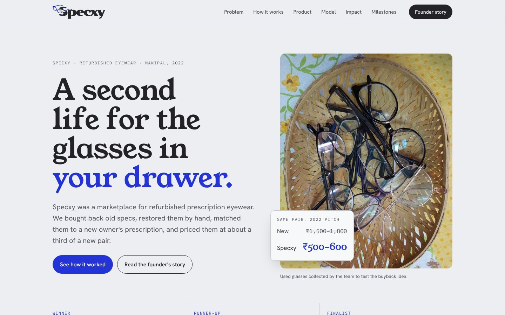

# Specxy: a second life for the glasses in your drawer

**Specxy (2022)** was a marketplace for refurbished prescription eyewear, founded by **Omkar Patil** at Manipal. We bought back old specs, restored them by hand, matched them to a new owner's prescription and priced them at about a third of a new pair.

**Live site:** https://specxy.netlify.app

## Results (2022)

| Result | Competition |
| --- | --- |
| Winner | Pitch Tank, Manipal Entrepreneurship Summit (MIT E-Cell × MUTBI) |
| Runner-up | Hult Prize MAHE |
| Finalist | Hult Prize Regional Summit, Dhaka |
| Finalist | MIT E-Cell Idea Validation Competition |
| Finalist | DTU Udyamee: The Shark Tank Competition |

## What's on the site

- The problem, and the buyback → wallet points → refurbished pair → subscription loop
- The 4-step refurbishing process, with before/after photos of frames the team restored
- A working rebuild of the 2022 prescription-matching app prototype ([walkthrough video](docs/specxy-app-walkthrough.mp4))
- Unit economics: ₹400 cost per pair, sold at ₹500–600 against ₹1,500–1,800 new
- Team and founder story

## My role

Founder and Team Lead. Idea, pitching, app prototype design, business model and unit economics, and the glasses collection and refurbishing trials.

## Tech

A single static page (HTML, CSS and vanilla JS) with no build step, deployed on Netlify. Fonts: Young Serif, Hanken Grotesk and IBM Plex Mono.

Run it locally by serving the folder (for example `npx serve .`). Opening the file directly can hide the logo, because browsers block CSS masks on file:// pages.

---
Market statistics on the site are as cited in the original 2022 pitch decks.
